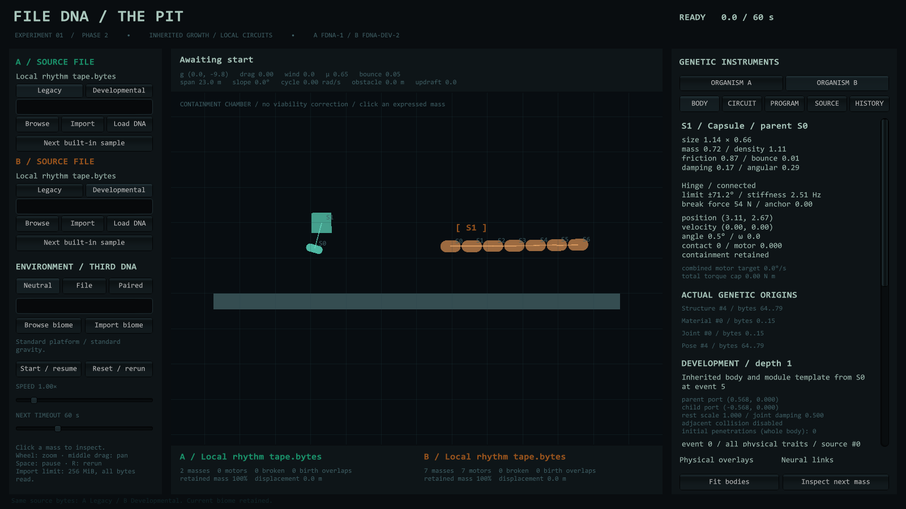
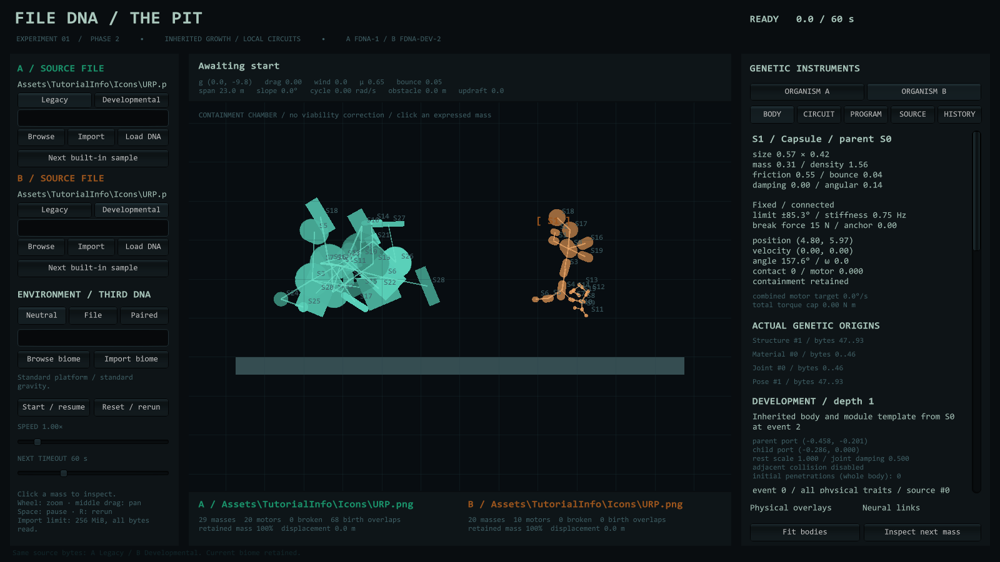
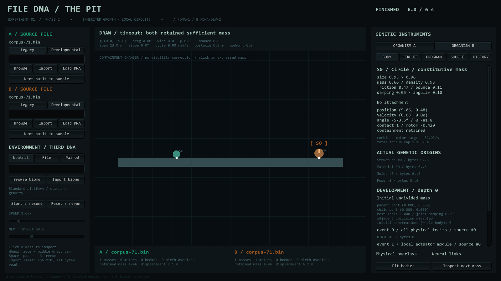

# Phase 2 evidence — October 30, 2026

The final source was compiled with Unity **6000.4.1f1**, built for Windows, tested in actual Editor Play Mode and tested again in a **graphics-enabled standalone player**. The Editor used an isolated project copy because the user's main project was open. Existing package versions and render-pipeline settings were used; no project dependency was added. The final player used the installed NVIDIA RTX 3050 Laptop GPU / Direct3D 12.

## Reproducible data

- [inputs.csv](inputs.csv): 395 inputs, their names, authored-demo flags, sizes and raw SHA-256 identities. There are 343 distinct raw contents; duplicates are retained as determinism probes, not counted as distinct discoveries.
- [anatomy.csv](anatomy.csv): 790 same-input expressed genotypes, Legacy and Developmental per input, with structural signatures, hierarchy, repeated motifs, size variation, circuits, failed buds and cap losses.
- [morphogenesis.txt](morphogenesis.txt): full count distributions and core assertion results. [editor-morphogenesis.txt](editor-morphogenesis.txt) is the independent Unity Editor run.
- [construction.csv](construction.csv): native collider queries before simulation, for **all 790 bodies / 4,392 masses**. Legacy has 2,509 overlapping pairs in 88 specimens; Developmental has zero. Invalid queries fail validation. Ready-state sprite/native pose agreement and new hinge/fixed anchor coincidence are also checked.
- [motion.csv](motion.csv): **70 isolated native motion trials**, 35 identical inputs per mode, eight simulated seconds unless eliminated. Its fixed index selection precedes runtime. Movement is measured after settling; candidate criteria are documented in [runtime-comparison.txt](runtime-comparison.txt).
- [environment.csv](environment.csv): three additional immutable-genotype comparisons in neutral versus third-file biomes.
- [runtime-comparison.txt](runtime-comparison.txt) and [editor-runtime-comparison.txt](editor-runtime-comparison.txt): actual standalone and Play Mode summaries. Both modes have four motion candidates in this subset, with zero numerical faults. Developmental breaks more joints, despite removing birth overlaps.
- [phase1-regression-physics.txt](phase1-regression-physics.txt) and its [Editor counterpart](editor-phase1-regression-physics.txt): original match-rule/replay/physics checks, retained as regressions.
- [phase2-player-complete.txt](phase2-player-complete.txt): completion marker written after native checks and actual rendered captures. A black framebuffer fails rather than becoming evidence.
- [build-sha256.txt](build-sha256.txt), [source-sha256.csv](source-sha256.csv), [phase1-preservation.txt](phase1-preservation.txt): build/source identities and byte-for-byte preservation of the original interpreter, reader, fixtures, picker and Phase 1 documentation/evidence.

The original files were already uncommitted. Their snapshot is retained under `Logs/FileDNALab/Phase2/Phase1Snapshot/`; no reset, commit or unrelated source edit was performed. The original Phase 1 evidence remains in the adjacent `Documentation/Evidence/` directory.

## Actual same-input photographs

**A / teal is Legacy; B / amber is Developmental.** Every pair receives identical bytes and the same neutral environment. Birth frames show the actual Ready-state physical plan; after frames show native autonomous results at up to six seconds. These are not static generated diagrams or an animation replay. The inspector displays the selected Developmental part, actual source ranges and parameters.

The selection is documented in [selection.txt](Screenshots/selection.txt) and [visual-inputs.csv](Screenshots/visual-inputs.csv): fixed representative indices, real C#/PNG inputs, plus **every locomotion candidate from either mode's predeclared trial subset**. The successful Legacy cases are included alongside successful Developmental cases. Authored tapes are explicitly marked in the input manifest. Initial/after comparisons are valid even when either organism falls or breaks; those results were not removed.

| Index / source | Birth | After |
|---|---|---|
| 000 Recipe text | [birth](Screenshots/000-birth.png) | [after](Screenshots/000-after.png) |
| 001 Phase 1 articulated tape, authored | [birth](Screenshots/001-birth.png) | [after](Screenshots/001-after.png) |
| 002 Phase 1 branch tape, authored | [birth](Screenshots/002-birth.png) | [after](Screenshots/002-after.png) |
| 004 Incremental bytes | [birth](Screenshots/004-birth.png) | [after](Screenshots/004-after.png) |
| 005 High-entropy bytes | [birth](Screenshots/005-birth.png) | [after](Screenshots/005-after.png) |
| 011 Sparse data, Legacy candidate | [birth](Screenshots/011-birth.png) | [after](Screenshots/011-after.png) |
| 023 Repeated byte pattern, Developmental candidate | [birth](Screenshots/023-birth.png) | [after](Screenshots/023-after.png) |
| 071 Seven incremental bytes, rolling Developmental sphere | [birth](Screenshots/071-birth.png) | [after](Screenshots/071-after.png) |
| 263 Sparse data, Legacy candidate | [birth](Screenshots/263-birth.png) | [after](Screenshots/263-after.png) |
| 384 Undivided sphere, authored | [birth](Screenshots/384-birth.png) | [after](Screenshots/384-after.png) |
| 385 Inherited local rhythm, authored | [birth](Screenshots/385-birth.png) | [after](Screenshots/385-after.png) |
| 386 Branch/return, authored | [birth](Screenshots/386-birth.png) | [after](Screenshots/386-after.png) |
| 387 Asymmetric growth, authored | [birth](Screenshots/387-birth.png) | [after](Screenshots/387-after.png) |
| 388 Obstructed curl, authored | [birth](Screenshots/388-birth.png) | [after](Screenshots/388-after.png) |
| 389 Elastic modules, authored | [birth](Screenshots/389-birth.png) | [after](Screenshots/389-after.png) |
| 390 Inert uniform bytes | [birth](Screenshots/390-birth.png) | [after](Screenshots/390-after.png) |
| 391 Actual original interpreter C# | [birth](Screenshots/391-birth.png) | [after](Screenshots/391-after.png) |
| 394 Actual URP PNG icon | [birth](Screenshots/394-birth.png) | [after](Screenshots/394-after.png) |

[1280×720 compact layout](the-pit-phase2-1280.png) supplements the 1600×900 captures. Representative birth/after and compact images were opened and visually inspected. The final render-only pose publication preserves native Legacy motion measurements while fixing the old Ready-state sprite pile-up.

These observations do not prove recognition, evolutionary fitness, stable walking, or cross-platform determinism. Native file-dialog interaction and non-Windows standalone execution remain manual/unperformed checks. See [Phase2Report.md](../Phase2Report.md) for interpretation, biases, failures and recommended experiments.
